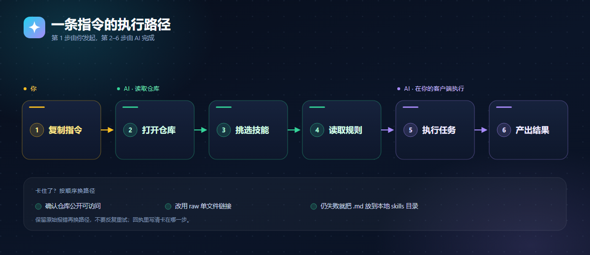
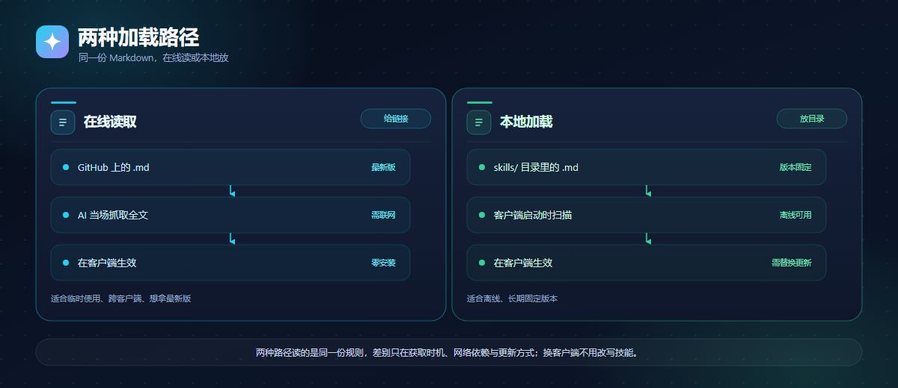

# any-skills


一个开放的 AI 技能仓库：每个技能就是一段 Markdown，开头写清用途与触发条件，正文是给 AI 的执行规则。不需要装插件，不需要改接口，AI 能读网页就能用。

## 复制即用

复制后把任务接在后面即可。

```text
使用https://github.com/chengzhaobing/any-skills/blob/main/skills/multi-agent.md技能完成下列任务***
```

## 使用流程与原理

### 一条指令怎么跑起来



第 1 步由你发起，第 2–6 步由 AI 完成；卡住时先看最后一列。

| 步骤 | 你做什么 | AI 做什么 | 失败怎么办 |
|---|---|---|---|
| 1 复制指令 | 整条复制，把 `***` 换成任务目标 | 等你发出任务 | 链接打不开：确认仓库公开、分支为 `main` |
| 2 打开仓库 | 不用操作 | 按 URL 定位 `skills/` 下的文件 | 读不到仓库：改发单文件链接 |
| 3 挑选技能 | 说清目标、约束与验收标准 | 按 `description` 匹配技能，不匹配会反问 | 没有匹配：让 AI 说明缺哪类技能 |
| 4 读取规则 | 不用操作 | 解析 frontmatter、流程与模板 | 内容截断：改用 `raw.githubusercontent.com` 链接 |
| 5 执行任务 | 提供项目上下文，确认关键决策 | 按技能步骤读文件、改文件、跑定向检查 | 没权限或没工具：换有文件权限的客户端，或本地加载 |
| 6 产出结果 | 验收产物与回执 | 给出改动清单、验证范围、未验证部分 | 结果不符：附上回执和验收标准，要求返工 |

### 为什么是「仓库 + 单个 Markdown」

- **不是插件**：插件要为每个客户端打包、安装、升级；Markdown 只要能读网页就能加载。
- **不是服务**：服务要部署、维护、保管密钥；技能文件不运行、不联网，也不接触凭据。
- **分工清晰**：仓库负责分发与版本（git 历史、fork、单文件链接），单个文件负责边界（一个技能一个文件，读哪个用哪个）。
- **跨客户端复用**：规则只写做什么、怎么做、怎么验收，不绑定模型或 API；读取与执行都由客户端自己完成。

### 两种加载路径



同一份 Markdown，两种拿法：在线读取零安装、始终最新；本地加载离线可用、版本固定。

| 路径 | 怎么加载 | 适合 |
|---|---|---|
| 在线读取 | 给仓库或单文件链接，AI 当场抓取 | 临时使用、跨客户端、想拿最新版 |
| 本地加载 | 放进客户端 skills 目录，启动时扫描 | 离线、长期固定版本 |

换客户端时不用改写技能：格式是通用 Markdown + YAML frontmatter，客户端只负责读与执行。

## 已收录技能

| 技能 | 用来做什么 | 文件 |
|---|---|---|
| 项目 CEO（多 Agent 总指挥） | 把项目拆成任务，派给多个 AI 员工（Trae、Claude Code、Codex 等），汇总回执、逐项验收 | [skills/multi-agent.md](skills/multi-agent.md) |

## 相比传统反代：无封号风险

传统反代接管你的账号凭据，改写客户端请求地址，把流量转发到自建或第三方中转上；为了摊平额度，往往还配一个多账号池做轮换。any-skills 完全不碰这条链路：**不接管账号凭据、不改客户端协议、不做多账号池轮换，流量与身份仍由官方通道直达**。它只是让 AI 从 GitHub 多读一段 Markdown，不新增任何登录、计费或调用路径；仓库本身也不运行代理服务，不保存任何密钥。

| 维度 | 传统反代 | any-skills |
|---|---|---|
| 账号凭据 | 要交出 token / Cookie / API Key，存在第三方服务端 | 不接触任何凭据，凭据只留在你的客户端里 |
| 客户端协议 | 改写 base_url，拦截或中转请求 | 不改任何配置，AI 照常直连官方接口 |
| 账号数量 | 常见多账号池轮换、额度共享 | 单账号，不轮换、不共享 |
| 流量特征 | 异地出口、多设备并发，调用画像异常 | 与平时对话一致，不产生额外调用 |
| 稳定性 | 依赖第三方服务的存活与风控对抗 | 只依赖 GitHub 的可读性，文本可随时 fork 到本地 |

这里的「无封号风险」指机制上不存在由**凭据共用、协议篡改、账号池轮换**产生的风险来源，不代表任何平台方的认证、许可或背书；具体使用仍以各家服务条款为准。

## 技能文件长什么样

```markdown
---
name: project-ceo
description: 什么时候用、听到哪些触发词用
---

# 标题

正文：角色、流程、模板、自检清单。
```

新增技能只需在 `skills/` 下新建 `<名字>.md`：`name` 唯一，`description` 写清触发条件，正文按 AI 能逐步执行的写法来写。

## 目录结构

```text
any-skills/
├── README.md
├── docs/
│   └── assets/
│       ├── og-architecture.png   # 1200×630 分享图
│       ├── og-architecture.svg   # 可编辑源文件
│       └── og-meta.html          # og:image / twitter:image 元信息
└── skills/
    └── multi-agent.md
```

## 分享预览

`docs/assets/og-architecture.png` 为 1200×630，可直接用作社交预览图。需要自定义页面时，把 [og-meta.html](docs/assets/og-meta.html) 里的 `og:image`、`twitter:image` 等标签放进页面 `<head>` 即可。
