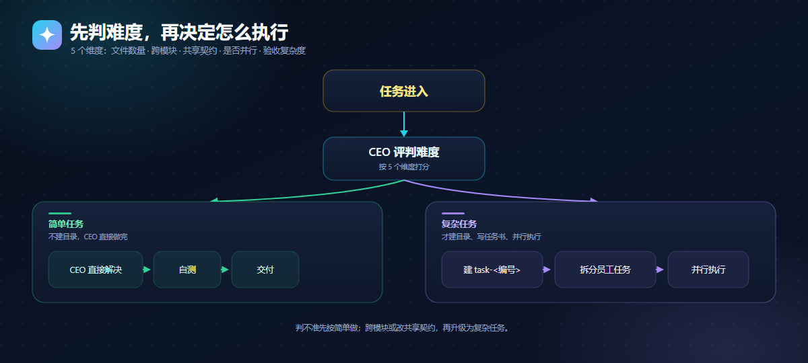
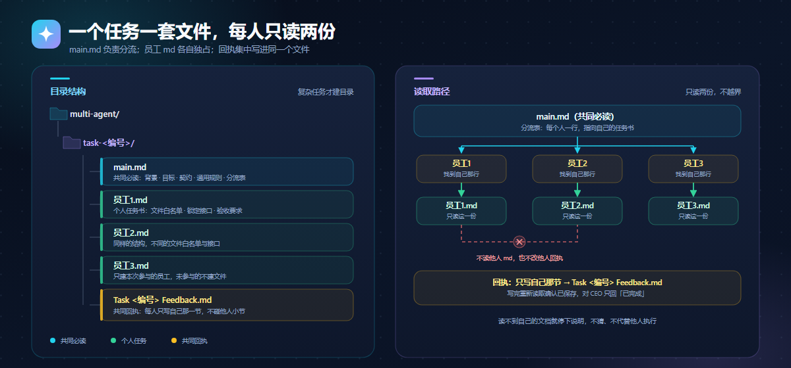
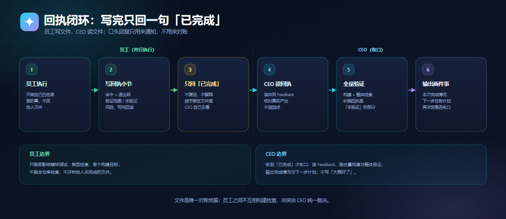

# any-skills


一个开放的 AI 技能仓库：每个技能就是一段 Markdown，开头写清用途与触发条件，正文是给 AI 的执行规则。不需要装插件，不需要改接口，AI 能读网页就能用。

## 复制即用

复制后把任务接在后面即可。

```text
使用https://github.com/chengzhaobing/any-skills/blob/main/skills/multi-agent.md技能完成下列任务***
```

## 使用流程与原理

### 任务难度分流



先判难度，再决定要不要编排；简单的默认 CEO 直接做完，不建目录也不派员工。

| 判定 | 典型特征 | 做法 |
|---|---|---|
| 简单（默认） | 单文件或少量文件、单模块、不改共享契约、无需并行 | CEO 直接解决 + 自测，不占编号 |
| 复杂 | 多文件跨模块、要改共享契约、可拆分并行、需整体验收 | 建 `multi-agent/task-<编号>/`，写任务书，并行执行 |

判不准先按简单做；做到一半发现跨模块或要改契约，再升级为复杂任务。

### 多 agent 目录约定



`main.md` 是所有员工共同先读的入口，员工按分流表找到自己那一行，只读自己那份任务书。

| 文件 | 作用 |
|---|---|
| `main.md` | 共同必读：任务背景、目标、接口契约、通用规则、分流表 |
| `员工1.md / 员工2.md / 员工3.md` | 各自任务书：文件白名单、锁定接口、验收要求 |
| `Task <编号> Feedback.md` | 共同回执：每人只写自己那一节 |

读取边界：不读他人的 md，不改他人的回执小节；读不到就停下说明，冲突由 CEO 裁决。

### 回执闭环



员工写文件、CEO 读文件，口头回复只用于通知：员工只回一句「已完成」，CEO 读 Feedback 核对真实产出，再跑全量构建与整体验证，最后给出「本次完成情况 + 下一步任务计划」。

并行期员工只做定向检查，全量检查留到 CEO 收口，避免多会话互相检出对方半成品。

### 为什么是「仓库 + 单个 Markdown」

- **不是插件**：插件要为每个客户端打包、安装、升级；Markdown 只要能读网页就能加载。
- **不是服务**：服务要部署、维护、保管密钥；技能文件不运行、不联网，也不接触凭据。
- **分工清晰**：仓库负责分发与版本（git 历史、fork、单文件链接），单个文件负责边界（一个技能一个文件，读哪个用哪个）。
- **跨客户端复用**：规则只写做什么、怎么做、怎么验收，不绑定模型或 API；读取与执行都由客户端自己完成。

## 已收录技能

| 技能 | 用来做什么 | 文件 |
|---|---|---|
| 项目 CEO（多 Agent 总指挥） | 把项目拆成任务，派给多个 AI 员工（Trae、Claude Code、Codex 等），汇总回执、逐项验收 | [skills/multi-agent.md](skills/multi-agent.md) |

## 相比传统反代：无封号风险

传统反代接管你的账号凭据，改写客户端请求地址，把流量转发到自建或第三方中转上；为了摊平额度，往往还配一个多账号池做轮换。any-skills 完全不碰这条链路：**不接管账号凭据、不改客户端协议、不做多账号池轮换，流量与身份仍由官方通道直达**。它只是让 AI 从 GitHub 多读一段 Markdown，不新增任何登录、计费或调用路径；仓库本身也不运行代理服务，不保存任何密钥。

| 维度 | 传统反代 | any-skills |
|---|---|---|
| 账号凭据 | 要交出 token / Cookie / API Key，存在第三方服务端 | 不接触任何凭据，凭据只留在你的客户端里 |
| 客户端协议 | 改写 base_url，拦截或中转请求 | 不改任何配置，AI 照常直连官方接口 |
| 账号数量 | 常见多账号池轮换、额度共享 | 单账号，不轮换、不共享 |
| 流量特征 | 异地出口、多设备并发，调用画像异常 | 与平时对话一致，不产生额外调用 |
| 稳定性 | 依赖第三方服务的存活与风控对抗 | 只依赖 GitHub 的可读性，文本可随时 fork 到本地 |

这里的「无封号风险」指机制上不存在由**凭据共用、协议篡改、账号池轮换**产生的风险来源，不代表任何平台方的认证、许可或背书；具体使用仍以各家服务条款为准。

## 技能文件长什么样

```markdown
---
name: project-ceo
description: 什么时候用、听到哪些触发词用
---

# 标题

正文：角色、流程、模板、自检清单。
```

新增技能只需在 `skills/` 下新建 `<名字>.md`：`name` 唯一，`description` 写清触发条件，正文按 AI 能逐步执行的写法来写。

## 目录结构

```text
any-skills/
├── README.md
├── docs/
│   └── assets/
│       ├── og-architecture.svg / .png      # 分享预览图（1200×630）
│       ├── readme-difficulty.svg / .png    # 任务难度分流图（1200×540）
│       ├── readme-directory.svg / .png     # 多 agent 目录结构图（1200×560）
│       ├── readme-feedback.svg / .png      # 回执闭环图（1200×520）
│       └── og-meta.html                    # og:image / twitter:image 元信息
└── skills/
    └── multi-agent.md
```

## 分享预览

`docs/assets/og-architecture.png` 为 1200×630，可直接用作社交预览图。需要自定义页面时，把 [og-meta.html](docs/assets/og-meta.html) 里的 `og:image`、`twitter:image` 等标签放进页面 `<head>` 即可。
