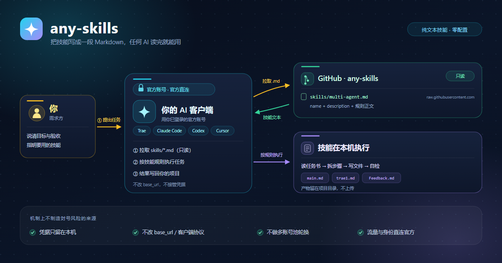

# any-skills



一个开放的 AI 技能仓库：每个技能就是一段 Markdown，开头写清用途与触发条件，正文是给 AI 的执行规则。不需要装插件，不需要改接口，AI 能读网页就能用。

## 复制即用

把仓库地址和下面这句话一起发给 AI：

**仓库地址**

```text
https://github.com/chengzhaobing/any-skills
```

**一句话指令**

```text
复制GitHub仓库地址，让AI读取使用
```

AI 会打开仓库，按你的目标挑出对应技能并执行。目标已经很明确时，也可以只给它单个技能文件：

```text
https://github.com/chengzhaobing/any-skills/blob/main/skills/multi-agent.md
```

想离线使用，把 `.md` 放进所用客户端的 skills 目录即可；各客户端目录位置不同，以其文档为准。

## 已收录技能

| 技能 | 用来做什么 | 文件 |
|---|---|---|
| 项目 CEO（多 Agent 总指挥） | 把项目拆成任务，派给多个 AI 员工（Trae、Claude Code、Codex 等），汇总回执、逐项验收 | [skills/multi-agent.md](skills/multi-agent.md) |

## 相比传统反代：无封号风险

传统反代接管你的账号凭据，改写客户端请求地址，把流量转发到自建或第三方中转上；为了摊平额度，往往还配一个多账号池做轮换。any-skills 完全不碰这条链路：**不接管账号凭据、不改客户端协议、不做多账号池轮换，流量与身份仍由官方通道直达**。它只是让 AI 从 GitHub 多读一段 Markdown，不新增任何登录、计费或调用路径；仓库本身也不运行代理服务，不保存任何密钥。

| 维度 | 传统反代 | any-skills |
|---|---|---|
| 账号凭据 | 要交出 token / Cookie / API Key，存在第三方服务端 | 不接触任何凭据，凭据只留在你的客户端里 |
| 客户端协议 | 改写 base_url，拦截或中转请求 | 不改任何配置，AI 照常直连官方接口 |
| 账号数量 | 常见多账号池轮换、额度共享 | 单账号，不轮换、不共享 |
| 流量特征 | 异地出口、多设备并发，调用画像异常 | 与平时对话一致，不产生额外调用 |
| 稳定性 | 依赖第三方服务的存活与风控对抗 | 只依赖 GitHub 的可读性，文本可随时 fork 到本地 |

这里的「无封号风险」指机制上不存在由**凭据共用、协议篡改、账号池轮换**产生的风险来源，不代表任何平台方的认证、许可或背书；具体使用仍以各家服务条款为准。

## 技能文件长什么样

```markdown
---
name: project-ceo
description: 什么时候用、听到哪些触发词用
---

# 标题

正文：角色、流程、模板、自检清单。
```

新增技能只需在 `skills/` 下新建 `<名字>.md`：`name` 唯一，`description` 写清触发条件，正文按 AI 能逐步执行的写法来写。

## 目录结构

```text
any-skills/
├── README.md
├── docs/
│   └── assets/
│       ├── og-architecture.png   # 1200×630 分享图
│       ├── og-architecture.svg   # 可编辑源文件
│       └── og-meta.html          # og:image / twitter:image 元信息
└── skills/
    └── multi-agent.md
```

## 分享预览

`docs/assets/og-architecture.png` 为 1200×630，可直接用作社交预览图。需要自定义页面时，把 [og-meta.html](docs/assets/og-meta.html) 里的 `og:image`、`twitter:image` 等标签放进页面 `<head>` 即可。
